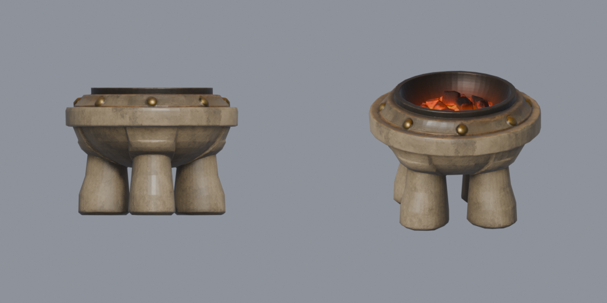
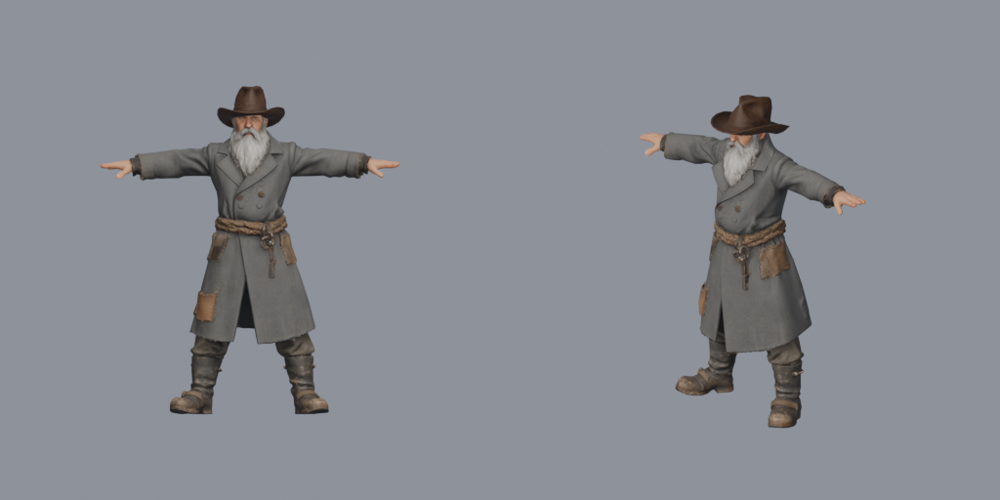

# Asset Forge - text to image to game-ready 3D, as an MCP server and agent skill

Generate game art **locally and for free on your own GPU**, from a coding agent or the
command line: concept images, icons, illustrations, and game-ready 3D models (`.glb`
with a baked normal map and PBR textures) from a text prompt or a picture.

Asset Forge drives [ComfyUI](https://github.com/comfyanonymous/ComfyUI) and wraps it in
the things an agent needs: one call per asset, background jobs, an automatic mesh check
with retry, a rendered preview the agent can look at, and settings that live in plain
JSON files instead of in a node graph.

```
text ──► image profile ──► picture ──► asset profile ──► .glb ──► mesh check ──► preview render
```

| "a squat stone brazier with a wide iron bowl full of glowing embers" | "an old grave keeper with a long grey beard, a patched grey wool coat..." |
| :---: | :---: |
|  |  |
| `prop_lowpoly` - 2,996 triangles - 5.4 min | `character_lowpoly` - 11,997 triangles - 4.2 min |

Timings are from an RTX 5080 (16 GB), the only hardware this has been measured on.

- **MCP server** - 7 tools (`list_profiles`, `generate_image`, `generate_asset`, `get_job`,
  `check_mesh`, `models`, `forge_status`), stdio, no dependencies of its own.
- **Skill** - [`skills/asset-forge/SKILL.md`](skills/asset-forge/SKILL.md), in the open
  Agent Skills format, teaches the agent the workflow and how to recover from a bad mesh.
- **Profiles** - each kind of image or asset is a small JSON file; new models are added
  by writing a profile, not code.
- **Works with** Claude Code, Claude Desktop, Codex, and any other MCP client.

## Requirements

- A working **ComfyUI** with an NVIDIA GPU (8 GB minimum, 16 GB recommended).
- **Blender** 4.x or newer (low-poly clean-up, normal baking, previews).
- The node packs and models the bundled workflows use. The quickest route is the
  installer from [PixelArtistry-Animated-Characters](https://github.com/pixelartistry/PixelArtistry-Animated-Characters)
  plus the UltraTex and ComfyUI-GGUF node packs, and Qwen-Image 2.1 for text-to-image.
  You do not have to work the list out by hand: `forge.py doctor` reads every workflow
  and reports the node types and model files that are missing, and `forge.py models`
  gives download links.

## Install

**1. Get the code and point it at ComfyUI**

```
git clone https://github.com/Noamcelermajer/text-to-3d-game-asset-mcp
cd text-to-3d-game-asset-mcp
python forge.py doctor
```

`doctor` finds ComfyUI when the folder sits next to or inside it. Otherwise set the
`ASSETFORGE_COMFY` environment variable to the ComfyUI folder (the one with `main.py`)
before the first run, or edit `comfy_root` in the `machine.json` it writes. Any Python 3.10+
can start Asset Forge; it hands over to ComfyUI's own Python for the parts that need
numpy and trimesh.

**2. Connect your agent** - pick one

| Agent | How |
| :--- | :--- |
| Claude Code and Codex, one command | `python forge.py connect` - registers the MCP server and installs the skill for both. `--claude` / `--codex` for one, `--project <dir>` for a single project, `--remove` to undo, `--dry-run` to preview. |
| Claude Code, as a plugin | `/plugin marketplace add Noamcelermajer/text-to-3d-game-asset-mcp` then `/plugin install asset-forge@asset-forge` |
| Claude Desktop | `python forge.py bundle` builds `dist/asset-forge.mcpb`; install it from Settings > Extensions. |
| Anything else that speaks MCP | Add the stdio server below to the client's config. |

```json
{"mcpServers": {"asset-forge": {"command": "python", "args": ["/path/to/forge.py", "mcp"]}}}
```

**3. Ask for an asset** - "make a low-poly prop of a rusted iron key for my game".

## Command line

```
python forge.py doctor                                   hardware, ComfyUI, Blender, model files
python forge.py profiles                                 what can be generated
python forge.py image  torch_icon "a burning torch" -p icon
python forge.py asset  iron_key "a chunky rusted iron key with a ring handle" --image-only
python forge.py asset  iron_key                          build the model from the approved picture
python forge.py batch  jobs.json --project D:\game       many assets: all images first, then all models
```

Every command prints one JSON object. Exit code `0` ok, `2` a mesh failed its check, `1` error.
ComfyUI is started automatically when it is not running.

## How agents use it

Generation takes minutes, longer than most clients wait for one tool call, so
`generate_image` and `generate_asset` start a background job (one at a time - there is
one GPU) and return either the result or a job id to poll with `get_job`. A finished job
comes back with the mesh statistics, any problems found, and a preview picture.

The recommended loop, which the skill teaches: `generate_asset` with `image_only` to
approve the concept picture in about a minute, then the same call without it to build
the model from that picture.

`forge.py connect` edits `~/.claude.json`, `~/.claude/skills/asset-forge/`,
`~/.codex/config.toml` and `~/.codex/skills/asset-forge/` (or, with `--project`, only
`.mcp.json`, `.claude/skills/` and `AGENTS.md` inside that project). Each edited file is
backed up once as `<file>.assetforge.bak`.

## Customising - four levels

Later levels override earlier ones.

1. **Profile** (`profiles/*.json`) - one way of making something: which graph to run,
   its parameters and defaults, the prompt template, retry rules.
2. **Hardware tier** - a profile's `tiers` block for 8 / 12 / 16 / 24 GB cards. The tier
   is detected by `doctor` and stored in `machine.json`.
3. **Project** (`<game>/assetforge.json`, created by `forge.py init <game>`):

   ```json
   {
     "style": "hand-painted dark fantasy, muted purples and tarnished brass",
     "output_dir": "assets/generated",
     "profiles": {
       "prop_lowpoly": {"params": {"tris": 2000}},
       "character_lowpoly": {"params": {"tris": 15000}}
     }
   }
   ```

   A project can also carry its own profiles in `<game>/assetforge_profiles/*.json`.
4. **Call** - `--set tris=5000` on the command line, or `params` in an MCP call.

### Writing a profile

Most new profiles are a few lines that extend an existing one:

```json
{
  "id": "prop_mobile",
  "extends": "prop_lowpoly",
  "title": "Mobile prop",
  "description": "800 triangles for mobile builds.",
  "params": {"tris": 800, "lowpoly_passes": 8}
}
```

A full profile has these parts:

| Key | Meaning |
| :--- | :--- |
| `kind` | `image` or `asset`. |
| `graph` | A ComfyUI workflow, either saved from the editor or exported in API format. Path is relative to the profile file. |
| `params` | The tunable values and their defaults. Only these can be overridden. |
| `set` | `"<node id>.<input>": value` - what to write into the graph. `"{tris}"` inserts a parameter; `{image_file}`, `{seed}`, `{full_prompt}`, `{blender}` are provided. |
| `seed_inputs` | Graph inputs that receive the seed. |
| `outputs` | Which save nodes produce which files (`node`, `ext`; `"keep": false` to discard). |
| `prompt_template` | Image profiles: wraps the user's prompt. `{prompt}` and `{style}` are filled in. |
| `image_profile` | Asset profiles: which image profile draws the concept picture. |
| `check`, `retry` | Mesh-check limits, and how parameters change on each retry. |
| `tiers` | Overrides per VRAM tier. |
| `vram_group` | Profiles in the same group keep their weights loaded between runs; VRAM is freed when the group changes. |
| `status` | `tested` once you have verified it on real output, otherwise `experimental`. |

### Adding a new model

The AI landscape moves quickly; nothing here is tied to one model.

1. Build or download a ComfyUI workflow that uses the model and confirm it runs in ComfyUI.
2. Save it into `workflows/` (editor format is fine).
3. Write a profile pointing at it: list the knobs you care about in `params`, map them to
   node inputs in `set`, name the save nodes in `outputs`.
4. Add the model's files to `models/catalog.json` (folder, size, download link) so
   `forge.py models` can report and fetch them. `doctor` reads the file names straight
   from the workflow, so missing files and missing node packs are reported automatically.
5. Run it, look at the result, then set `"status": "tested"`.

## Models and hardware

`forge.py models` lists, per profile, the files it needs and which are missing, plus
advice for the detected GPU. `forge.py models --install <file> ...` downloads files that
have a link in the catalog.

Only the 16 GB tier has been measured (RTX 5080). The 8, 12 and 24 GB settings are
starting points and are marked as unmeasured in the catalog.

## Layout

```
forge.py              command line and MCP entry point
machine.json          detected hardware and paths (edit to override)
assetforge/           the engine (no dependencies beyond what ComfyUI ships)
profiles/             built-in profiles;  profiles/user/ for your own
workflows/, graphs/   the ComfyUI graphs the profiles run
models/catalog.json   model files, download links, per-tier advice
skills/asset-forge/   the skill (Agent Skills format) installed into Claude and Codex
.claude-plugin/       Claude Code plugin + marketplace manifests;  .mcp.json for the plugin
output/               default output folder when no project is given (not in git)
```

To move Asset Forge to another machine: copy this folder, run `forge.py doctor`, then
`forge.py models` to see what needs downloading.

## Status and limits

- Profiles marked `tested` (`concept_prop`, `concept_character`, `prop_lowpoly`,
  `character_lowpoly`) have been run end to end and inspected. `icon`, `illustration` and
  `prop_hero` are `experimental`.
- Thin, lace-like or caged shapes are the usual failure; the mesh check catches them and
  the skill explains the fixes (`thin` parameter, a chunkier prompt).
- The character profile asks for an A-pose; the image model sometimes draws a T-pose.

## License

MIT - see [LICENSE](LICENSE). The bundled workflows are from PixelArtistry (MIT); models
and node packs are not included and keep their own licenses - see
[THIRD_PARTY_NOTICES.md](THIRD_PARTY_NOTICES.md).
